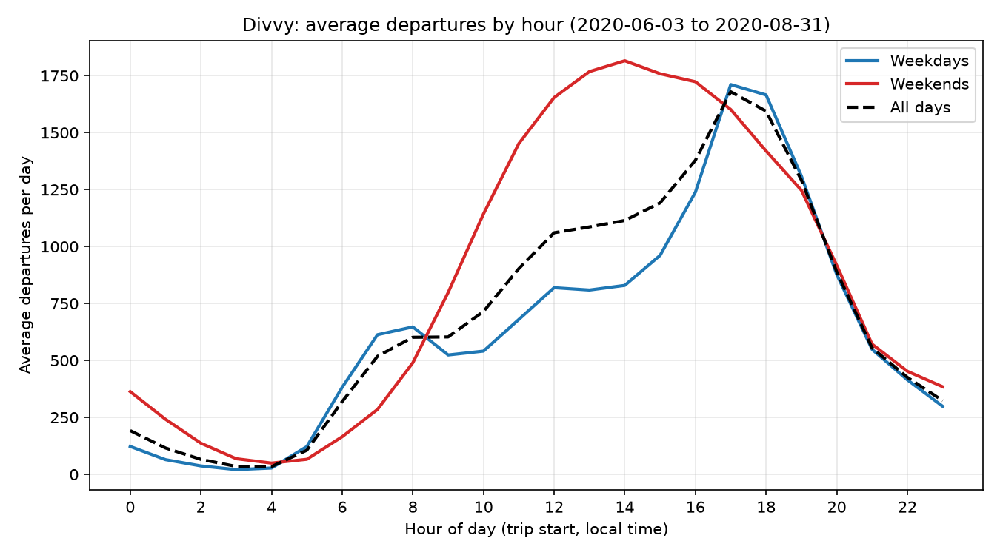

# Chicago Divvy Trips Pipeline

A small data warehouse for Chicago's Divvy bike-share system. Three months of public trip CSVs go into **DuckDB** via **Python**, get cleaned and quality-checked, and are analysed with **SQL** to answer:

1. Which stations see the most departures?
2. When does demand peak?
3. How do weekday and weekend patterns differ?

```
data/raw/*.csv ──► raw_trips ──► dq_flags / dq_duplicates ──► clean_trips ──► analysis tables ──► CSVs + chart
 (you download)    (verbatim +     (rule failures,             (typed, 1 row    (hourly, weekday/
                    source_file)    duplicate origin)           per ride_id)     weekend, top-10)
```

## Repository layout

| Path | What it is |
|---|---|
| `divvy_pipeline.py` | Loader, orchestration, CSV export, chart |
| `sql/01_schema.sql` | `raw_trips` and `load_log` tables |
| `sql/02_quality_flags.sql` | `dq_flags` (one row per record per failed rule) and `dq_duplicates` |
| `sql/03_clean_trips.sql` | `clean_trips`, plus `dq_removed_duplicates` audit table |
| `sql/04_dq_report.sql` | `dq_report`: loaded / flagged / deduplicated / kept, with reasons |
| `sql/05_analysis.sql` | Hourly, weekday-vs-weekend, and windowed station ranking |
| `data/sample/` | Tiny two-file dataset with deliberately bad records (used by the tests) |
| `tests/test_pipeline.py` | One test per data-quality rule, plus idempotency and analysis checks |

## Setup

Requires Python 3.9+.

```bash
git clone <your-repo-url> && cd divvy-pipeline
python -m venv .venv && source .venv/bin/activate     # Windows: .venv\Scripts\activate
pip install -r requirements.txt
```

### Try it on the sample data (no download needed)

```bash
pytest                                                    # verifies every rule
python divvy_pipeline.py --input data/sample --db warehouse/sample.duckdb --out outputs/sample
```

### Run on the real data

1. Go to the Divvy system-data page (<https://divvybikes.com/system-data>), which links to the S3 bucket of trip files (`https://divvy-tripdata.s3.amazonaws.com/index.html`).
2. Download **three consecutive months**, e.g. `202406-divvy-tripdata.zip`, `202407-divvy-tripdata.zip`, `202408-divvy-tripdata.zip`, and unzip them into `data/raw/`. The full CSVs are git-ignored; they are not in this repo. Use the data under Divvy's data license agreement.
3. Run:

```bash
python divvy_pipeline.py --input data/raw --db warehouse/divvy.duckdb --out outputs
```

Outputs land in `outputs/`:

| File | Contents |
|---|---|
| `dq_report.csv` | Rows loaded / flagged (per rule) / deduplicated / kept |
| `dq_flagged_records.csv` | Every flagged record with `source_file`, `source_row`, `ride_id`, and the **rule it failed** |
| `dq_duplicates.csv`, `dq_removed_duplicates.csv` | Duplicate IDs, whether `within_file` or `across_files`, and which copy was kept |
| `station_top10_monthly.csv` | Top 10 start stations per month |
| `hourly_departures.csv` | Average departures per day by hour (all / weekday / weekend) |
| `weekday_weekend_summary.csv` | Trips, number of days, **average trips per day**, average duration, peak hour |
| `avg_departures_by_hour.png` | The chart |

Explore the warehouse yourself: `duckdb warehouse/divvy.duckdb` (or `duckdb.connect(...)` in Python) and query `clean_trips`, `station_rank_monthly`, etc.

The loader expects the current Divvy column layout (`ride_id`, `started_at`, ..., `member_casual`), which I verified on the June-August 2020 files, and stops with a clear error naming any missing column. Older files with the pre-2020 layout (`trip_id`, `start_time`, ...) are not supported.

## How each step works

### 1. Load (idempotent)
All columns are loaded as text, exactly as written in the CSV, plus `source_file` and `source_row` so any record can be traced to its input line. Each file is loaded in a transaction as **delete-by-`source_file`, then insert**, and a `load_log` stores each file's SHA-256 so unchanged files are skipped. Running it twice therefore cannot inflate counts; if a file is edited and re-run, it is *replaced*, not appended. `dq_report` includes `repeat_load_rows`, which must be 0.

### 2. Clean
`clean_trips` has one row per `ride_id` with parsed `started_at`/`ended_at`, `duration_min`, `trip_month`, `day_of_week` (ISO: 1 = Mon … 7 = Sun), `day_type`, and `start_hour` (all derived from the start timestamp).

### 3. Data-quality rules

| Rule | Fails when |
|---|---|
| `missing_ride_id` | `ride_id` is NULL or blank |
| `missing_started_at` / `missing_ended_at` | timestamp is NULL or blank |
| `unparseable_started_at` / `unparseable_ended_at` | timestamp present but not a valid timestamp |
| `ends_before_start` | both parse, but end < start |

A record can fail several rules (each shows up in `dq_flagged_records.csv`). Flagged records are excluded from `clean_trips`. **Duplicates are tracked separately**: after flagged rows are removed, the earliest `(source_file, source_row)` per `ride_id` is kept, and every dropped copy is recorded with the copy it lost to and whether it was identical. `dq_duplicates` labels the origin as `within_file` or `across_files`; a repeated load can't be the cause because of the idempotent load above.

### 4. Analysis
- **Stations:** `row_number() OVER (PARTITION BY trip_month ORDER BY count(*) DESC, station)`, so ties break deterministically and each month has exactly 10 rows at most.
- **Hours:** every hour 0-23 appears, including zero-trip hours.
- **Weekday vs weekend:** *average trips per day* = trips ÷ calendar days of that type between the first and last trip date, so five weekdays don't look busier than two weekend days just by count.

## Example output (from `data/sample`)

`dq_report.csv`:

| metric | rule | rows |
|---|---|---:|
| rows_loaded | | 21 |
| rows_flagged | | 8 |
| flagged_by_rule | missing_ride_id | 2 |
| flagged_by_rule | missing_started_at | 1 |
| flagged_by_rule | missing_ended_at | 1 |
| flagged_by_rule | unparseable_started_at | 2 |
| flagged_by_rule | unparseable_ended_at | 1 |
| flagged_by_rule | ends_before_start | 2 |
| duplicates_removed | | 2 |
| duplicate_extra_copies_by_origin | within_file | 1 |
| duplicate_extra_copies_by_origin | across_files | 1 |
| repeat_load_rows | | 0 |
| rows_kept | | 11 |
| kept_missing_start_station | | 1 |
| unaccounted_rows | | 0 |

(8 flagged records but 9 rule hits: one record has both a missing ID and an unparseable start time.)

`station_top10_monthly.csv`:

| trip_month | rank_in_month | start_station_name | departures |
|---|---:|---|---:|
| 2024-01-01 | 1 | Clark St & Elm St | 3 |
| 2024-01-01 | 2 | Streeter Dr & Grand Ave | 2 |
| 2024-02-01 | 1 | Clark St & Elm St | 3 |
| 2024-02-01 | 2 | Streeter Dr & Grand Ave | 1 |
| 2024-02-01 | 3 | Wells St & Concord Ln | 1 |

*(These are sample-data numbers, only for illustrating the format. They say nothing about real ridership.)*

## A decision I made: keep trips with missing stations in citywide totals

Some valid rides have no start station name (dockless/e-bike trips are the usual cause). I could have dropped them as "bad data". I didn't, because the missing field only affects *where*, not *whether* or *when* the ride happened. Dropping them would undercount citywide demand and distort the hourly and weekday/weekend profiles, especially if missing-station trips cluster at certain hours or on certain bike types. So they stay in `clean_trips` (`has_start_station = false`) and in every citywide figure, and are excluded only from `station_rank_monthly`, where a station name is required. `dq_report` shows the count (`kept_missing_start_station`) so the choice is visible, and `sum(departures)` in the ranking will be lower than the citywide total by exactly that number.

Related choice: records with an unparseable or missing timestamp are *excluded*, because without a start time they can't be placed in any hour, day, or month, and guessing would be worse than a visible flag.

## Findings from my run

I ran the pipeline on three months of real Divvy data: **June, July and August 2020** (1,516,846 rows loaded, 1,511,863 kept). Re-running on the same files skipped all three (`skipped (unchanged)`) and left every count identical.



| day_type | days | trips | avg trips/day | avg duration (min) | member % | peak hour |
|---|---:|---:|---:|---:|---:|---:|
| weekday | 64 | 976,969 | 15,265.1 | 30.9 | 57.3 | 17:00 |
| weekend | 26 | 534,894 | 20,572.8 | 39.2 | 44.9 | 14:00 |

Top 3 start stations (`station_top10_monthly.csv`):

| Month | #1 | #2 | #3 |
|---|---|---|---|
| Jun 2020 | Streeter Dr & Grand Ave (4,001) | Clark St & Elm St (3,340) | Lake Shore Dr & North Blvd (3,020) |
| Jul 2020 | Streeter Dr & Grand Ave (8,575) | Lake Shore Dr & Monroe St (6,370) | Theater on the Lake (6,162) |
| Aug 2020 | Streeter Dr & Grand Ave (9,348) | Theater on the Lake (8,755) | Lake Shore Dr & Monroe St (6,863) |

**Data quality (from `dq_report.csv`):** 4,983 trips (0.33%) were flagged, all for `ends_before_start`. In the raw rows these are mostly a few seconds apart (median 9 s) and 99.9% are docked bikes, so they look like timestamp glitches on very short docking events rather than parsing errors. No ride IDs were duplicated. 7,744 kept trips have no start station and all of them are electric bikes, which is why keeping them in citywide totals matters (see the decision above).

**Finding:** Weekends were busier per day than weekdays, and the peaks differ. After normalising by the number of days of each type, weekends averaged 20,573 departures per day versus 15,265 on weekdays (about 35% more). Weekday demand peaks at 17:00 (about 1,700 departures per day) with a smaller morning bump around 08:00 (about 650). Weekend demand peaks at 14:00 (about 1,800). Members made a larger share of weekday trips (57.3%) than weekend trips (44.9%), and weekend trips were longer on average. Streeter Dr & Grand Ave was the top departure station in all three months, and the rankings are dominated by lakefront and park locations.

**Limitations:**
1. Three months is not a full year, and June to August is peak season. These patterns should not be read as year-round ridership; winter volumes and peak hours would likely look very different.
2. The data is from summer 2020, during the COVID-19 pandemic, when commuting and leisure patterns were unusual. The weekday/weekend gap and peak hours may differ in other years.
3. The June 2020 file starts on June 3, so June 1-2 are absent. Per-day averages use the 90 days that exist (64 weekdays, 26 weekend days).
4. Station rankings exclude the 0.5% of trips with no start station (all electric bikes), so they slightly understate electric-bike activity at stations.
5. Very short and very long rides that pass the validity rules are still included, and the data cannot show *why* patterns occur (for example, whether lakefront stations lead because of leisure riding), only that they do.

## Tests

```bash
pytest -v
```
Covers each rule individually (including a record failing two rules), within-file vs across-file duplicates, reconciliation (`loaded = flagged + deduplicated + kept`), missing-station handling, idempotent re-runs, replaced-not-appended reloads, the window-function ranking with a tie, and per-day normalisation.
